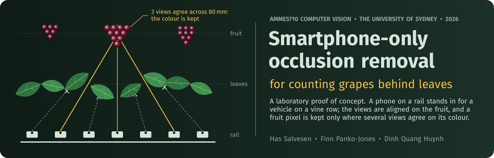
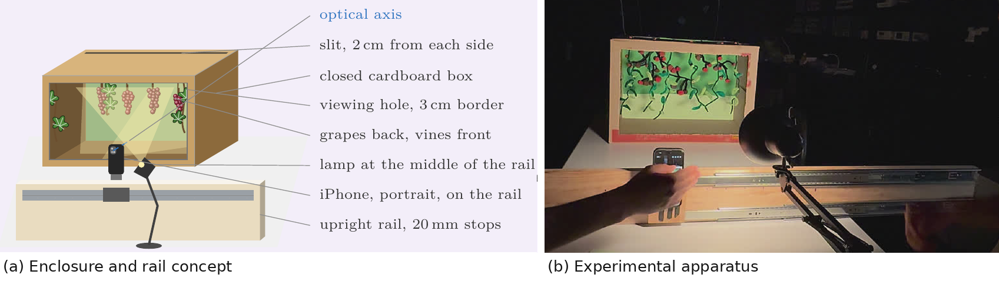
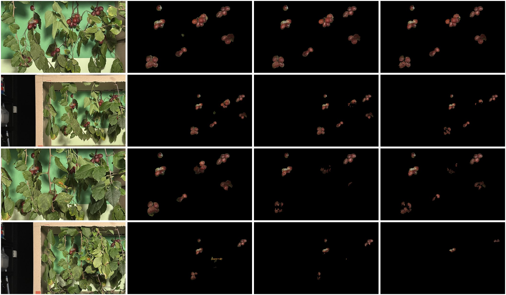

<p align="center">
  
</p>

<p align="center">
  <a href="report/report.pdf"><b>Report (PDF)</b></a> ·
  <a href="#what-this-is-and-what-it-is-not">Scope</a> ·
  <a href="#results">Results</a> ·
  <a href="#how-it-works">Method</a> ·
  <a href="#repository-layout">Layout</a> ·
  <a href="#reproducing-the-results">Reproduce</a> ·
  <a href="#related-work">Related work</a> ·
  <a href="#limitations">Limitations</a> ·
  <a href="#team">Team</a>
</p>

<p align="center">
  <a href="https://www.python.org/"></a>
  <a href="https://opencv.org/"></a>
  <a href="https://github.com/facebookresearch/sam3"></a>
  <a href="https://github.com/tong-xz/GrapeSAM"></a>
  <a href="LICENSE"></a>
</p>

# Smartphone-Only Occlusion Removal for Estimating Healthy Grape Yield

AMME5710 Computer Vision and Image Processing, The University of Sydney, 2026.
Has Salvesen, Finn Panko-Jones and Dinh Quang Huynh.

Leaves hide fruit from any single camera position, so a camera-based crop estimate undercounts.
A vehicle driving along a vine row cannot steer its camera around each leaf, but as it moves it
records a dense sweep of sideways views in which the near foliage shifts more than the fruit
behind it. This project tests, in the laboratory, whether that passive sweep, captured by one
ordinary phone, recovers enough of the hidden fruit to improve a downstream task: counting
grapes.

## What this is, and what it is not

- **What we built.** A pipeline that segments fruit and foliage in every photo with SAM 3, aligns
  the photos on features found only on the fruit, and composes one fruit-only image from colours
  that at least three views, spanning at least 40 mm, agree on. Nothing is painted in: a pixel
  that no view saw stays empty.
- **How we tested it.** A phone on a horizontal rail stood in for the vehicle. Four captures of
  one arrangement of red grapes behind 3 to 6 foreground branches, 28 photos each at 20 mm steps,
  with 40 and 60 mm spacings made by subsampling. Pixel scores are against a leaf-free photograph
  of the same fruit; counts come from GrapeSAM, a berry detector trained on a vineyard dataset and
  not tuned on our data, matched against 25 hand-labelled grapes.
- **What it is not.** It is not a yield estimator: it estimates no fruit mass, ripeness or vine
  health. It was not tested outdoors, on green grapes, on a moving vehicle or on a second
  arrangement of fruit. The title names the aim; the work evaluates the occlusion-removal step.

## Results

At 20 mm spacing with SAM 3 masks (Table 1 of the report, from
[results/report/results_full.csv](results/report/results_full.csv)). "Single" is the occluded
reference photo; the interval is the bootstrap 95 % interval over the 25 grapes for the gain in
count F1.

| Foreground branches | Views kept | Pixel recall, single | Pixel recall, reconstruction | Pixel precision, reconstruction | Count F1, single | Count F1, reconstruction | F1 gain, 95 % interval |
| :-: | :-: | :-: | :-: | :-: | :-: | :-: | :-: |
| 3 | 28 of 28 | 68 % | 94 % | 80 % | 0.62 | 0.79 | +0.07 to +0.31 |
| 4 | 28 of 28 | 49 % | 87 % | 80 % | 0.56 | 0.76 | +0.04 to +0.39 |
| 5 | 28 of 28 | 42 % | 87 % | 82 % | 0.42 | 0.77 | +0.18 to +0.56 |
| 6 | 14 of 27 | 25 % | 42 % | 77 % | 0.14 | 0.55 | +0.20 to +0.62 |

- **The gain depends on how many views align.** At six branches only 14 of 27 views passed the
  alignment check, and whole bunches are missing from the reconstruction.
- **Wider spacing helped only under light occlusion.** Three branches at 40 mm gave the best count
  F1 (0.88). At six branches and 60 mm, 3 of 9 views aligned and GrapeSAM detected nothing.
- **Alignment matters more than the fusion rule** (Table 2). The depth-shift synthetic aperture of
  our first prototype fell to F1 0.08 at five branches; the same statistics on our alignment
  reached 0.44 to 0.72. Consensus fusion combined 87 % recall with 82 % precision at five
  branches. Its count F1 differs from the next-best rules by about as much as a 5 px registration
  error changes the score (up to 0.08), so we do not read those differences as a ranking.
- **The counter overcounts.** GrapeSAM found 29 to 40 berries in the leaf-free photograph of 25
  labelled grapes (F1 0.74 to 0.81), which is why detections are matched to labels rather than
  totals compared.
- **It is slow.** Loading and alignment took 16 s and fusion 209 s per reconstruction (NumPy on the CPU of a
  laptop with an RTX 2000 Ada GPU); SAM 3 took 1.5 s per photo. Offline analysis only.

Every number on this page and every cell of the report's Tables 1 to 3 is checked against the
committed result files by [tools/check_report_numbers.py](tools/check_report_numbers.py).

## How it works

<table>
  <tr>
    <td width="50%"></td>
    <td width="50%"></td>
  </tr>
  <tr>
    <td><sub>The rig: a phone on a horizontal rail photographs red grapes behind removable branches.</sub></td>
    <td><sub>Rows: 3 to 6 branches. Columns: the occluded reference view, then reconstructions at 20, 40 and 60 mm. Black means no view saw fruit there.</sub></td>
  </tr>
</table>

| Step | What happens | Code |
| --- | --- | --- |
| Segment | SAM 3 text prompts: `grape` for fruit; `green leaf`, `green vine` and `green stem` for foliage, dilated, with fruit winning where they overlap. | [App/Segmentation/make_masks.py](App/Segmentation/make_masks.py), [grape_segment.py](grape_segment.py) |
| Match | SIFT features only inside each view's fruit mask, matched to four neighbouring views with a reciprocal ratio test; a quarter of the matches is held out. | [grape_restore_autoref.py](grape_restore_autoref.py) `fit_pair`, `build_edges` |
| Validate pairs | A RANSAC similarity per pair, kept only with enough inliers and a plausible scale and rotation. | `fit_pair` |
| Solve poses | One similarity per view, solved jointly by iteratively reweighted least squares with the reference fixed; a view whose held-out error exceeds 3 px is dropped. | `solve_motion` |
| Fuse | A pixel becomes fruit only if at least 3 views spanning at least 40 mm agree on its colour (within 30 RMS in RGB); one observed source pixel is copied, and specks under 25 px are removed. | `fuse_tile`, `clean_small_regions` |
| Count and score | GrapeSAM berry points (confidence 0.05) matched one-to-one to the 25 labels within 24 px; pixel recall and precision against the registered leaf-free photograph. | [grape_count.py](grape_count.py), [grape_evaluate.py](grape_evaluate.py), [run_experiments.py](run_experiments.py) |

## Repository layout

```
grape_io.py                  read rail sequences and masks
grape_segment.py             SAM 3 and colour-rule fruit and foliage masks
grape_restore_autoref.py     the method: fruit-only registration, joint pose solve, consensus fusion
grape_count.py               berry counting: GrapeSAM, Hough circles, SAM 3 instances, watershed
grape_evaluate.py            pixel and count metrics, truth registration, the labelling tool
run_experiments.py           the main study (Table 1)
analyse_experiments.py       adds the fruit-only count scores to the main study
run_ablations.py             baselines, ablations, uncertainty and runtime (Tables 2 and 3, Figs. 5 and 6)
make_ablation_assets.py      LaTeX tables and plots from results/ablation
make_report_assets.py        draft tables from results/report, written into an Overleaf folder
labels/                      the 25 grape labels on the leaf-free photograph
results/                     per-run diagnostics and scores; images are git-ignored
third_party/                 SAM 3 and GrapeSAM as git submodules, a patch, how to get the weights
tools/                       check_report_numbers.py
App/Capturing/               the rig, the capture procedure and HEIC conversion
App/Segmentation/            make_masks.py, which made the study's SAM 3 masks
App/Explored/                the earlier prototypes and the COLMAP experiment
has_sai/                     a colour-free, depth-based variant, tested in simulation
data/                        the captures (not in git; its README says where they are)
report/                      the report's LaTeX source and PDF
docs/banner/                 this page's banner, drawn in TikZ by make_banner.py
```

Each folder has a README: [results](results/README.md), [data](data/README.md),
[labels](labels/README.md), [third_party](third_party/README.md),
[App/Capturing](App/Capturing/README.md), [App/Segmentation](App/Segmentation/README.md),
[App/Explored](App/Explored/README.md) and [has_sai](has_sai/README.md).

## Reproducing the results

### From the committed results (no photographs, no GPU, a few minutes)

```bash
python3 -m venv .venv && .venv/bin/pip install -r requirements.txt
.venv/bin/python tools/check_report_numbers.py   # Tables 1-3 and the quoted numbers against results/
.venv/bin/python make_ablation_assets.py         # rebuilds results/ablation/assets
```

`./reproduce.sh` runs both. The asset script reproduces the LaTeX tables byte for byte; the
plots match but can differ by a pixel with other fonts. The qualitative grid (Fig. 4) needs the
run images, which are not in git, so it is skipped. `./reproduce.sh --synthetic` adds
has_sai's 44-scene synthetic benchmark (about 20 minutes on three cores).

### The whole study (needs the data, the model weights and a CUDA GPU)

1. Fetch and patch the submodules, and get the weights (details in
   [third_party/README.md](third_party/README.md)):

   ```bash
   git submodule update --init
   git -C third_party/sam3 apply ../patches/sam3_local.patch
   ```

   SAM 3 needs access to `facebook/sam3` on Hugging Face; the GrapeSAM point model goes at
   `third_party/weights/point/best_val.pth`.
2. Put the four captures and the leaf-free photograph in `data/` ([data/README.md](data/README.md)).
3. Make the masks for each capture, and the truth mask of the leaf-free photograph:

   ```bash
   PYTHONPATH=third_party/sam3 python3 App/Segmentation/make_masks.py \
       --input data/2cm_74cm_5branches/images --output data/2cm_74cm_5branches --grape-masks
   mkdir -p results/refactor_check/truth && cp data/20261022_034827542_iOS.jpg results/refactor_check/truth/t1.jpg
   python3 grape_segment.py --images results/refactor_check/truth/t1.jpg \
       --out results/refactor_check/truth/t1 --fruit-prompt cherry --grape-only
   ```

   `run_ablations.py` notes that the truth mask used the prompt `cherry`; confirm with Finn
   before relying on it.
4. Run the study, then the baselines and ablations:

   ```bash
   python3 run_experiments.py --truth data/20261022_034827542_iOS.jpg \
       --truth-grapes results/refactor_check/truth/t1/grape_masks/t1.png \
       --labels labels/t1.csv --weights third_party/weights/point/best_val.pth
   python3 analyse_experiments.py
   python3 run_ablations.py launch
   python3 run_ablations.py a1 a2 a34 a5 a6 a7 a8
   python3 make_ablation_assets.py
   ```

`./reproduce.sh --full` does steps 3 and 4 once the inputs are in place. Each run is cached in
its folder, so an interrupted run resumes. To reconstruct a single capture:

```bash
python3 grape_restore_autoref.py --images data/2cm_74cm_5branches/images \
    --grape-masks data/2cm_74cm_5branches/grape_masks --foliage-masks data/2cm_74cm_5branches/removal_masks \
    --scale 0.8 --spacing 20 --out results/single/2cm_74cm_5branches
```

The script's default scale is 0.4 and the study used 0.8; its pixel thresholds are in processing
pixels. `--spacing` is the rail distance between consecutive photos in the folder, so a 40 mm
run needs a folder of every second photo and `--spacing 40`. Fewer than three aligned views ends
a run with a message, as at six branches and 60 mm.

## Related work

The literature behind the project, with how each work relates to it. DOIs were checked against
Crossref or the publisher on 8 November 2026.

**Occlusion, and why several views help**

| Work | How it relates |
| --- | --- |
| Bac et al., [J. Field Robotics 2014](https://doi.org/10.1002/rob.21525) | Review of 50 harvesting robots: 85 % fruit localisation, 66 % harvest success, little progress in three decades, with occlusion a frequent cause of failure. The motivation. |
| Íñiguez et al., [Agronomy 2021](https://doi.org/10.3390/agronomy11051003) | In vineyards, leaf occlusion lowered the accuracy of image-based yield estimates (R² from 0.77 to 0.63). The field problem behind this work. |
| Hemming et al., [Sensors 2014](https://doi.org/10.3390/s140406032) | Combining camera positions raised sweet-pepper detectability from at most 69 % to 90 %. The closest analogue of our multi-view gain, on a different measure. |
| Magalhães et al., [J. Intell. Robot. Syst. 2022](https://doi.org/10.1007/s10846-022-01595-3); Burusa et al., [Biosyst. Eng. 2024](https://doi.org/10.1016/j.biosystemseng.2024.08.002) | Active perception: a manipulator chooses the next view of each fruit. A vehicle on a fixed row cannot, which is why we use the views its motion supplies. |

**Vineyard yield estimation and berry counting**

| Work | How it relates |
| --- | --- |
| Nuske et al., [J. Field Robotics 2014](https://doi.org/10.1002/rob.21541); Millán et al., [J. Sensors 2018](https://doi.org/10.1155/2018/9634752) | Count visible berries from a vehicle and correct for hidden fruit statistically (calibration, a Boolean model). We try to observe more of the fruit before any such correction. |
| Aquino et al., [Biosyst. Eng. 2017](https://doi.org/10.1016/j.biosystemseng.2016.12.011) and [Comput. Electron. Agric. 2018](https://doi.org/10.1016/j.compag.2018.02.021) (vitisBerry); Liu et al., [Comput. Electron. Agric. 2020](https://doi.org/10.1016/j.compag.2020.105360) | Berry counting from single smartphone photos of visible bunches. Our counting stage plays this role after de-occlusion. |
| Zabawa et al., [ISPRS J. 2020](https://doi.org/10.1016/j.isprsjprs.2020.04.002); Coviello et al., [Appl. Sci. 2020](https://doi.org/10.3390/app10144870) (GBCNet) | Segmentation-based and density-based berry counters: alternatives to the point detector we use. |
| Tong et al., [arXiv 2026](https://arxiv.org/abs/2605.24353) (ViViD-5K, [GrapeSAM code](https://github.com/tong-xz/GrapeSAM)) | The vineyard dataset and berry point model we apply unchanged as an independent counter. |
| Kierdorf et al., [Front. AI 2022](https://doi.org/10.3389/frai.2022.830026); Quiñones et al., [J. Imaging 2025](https://doi.org/10.3390/jimaging11020034) (GCNet) | Learned prediction of berries hidden behind leaves. They address fruit that no view saw, which we cannot; the approaches are complementary. |
| Barriguinha et al., [Agronomy 2021](https://doi.org/10.3390/agronomy11091789); Laurent et al., [Eur. J. Agron. 2021](https://doi.org/10.1016/j.eja.2021.126339) | Reviews of vineyard yield estimation, for the wider context. |

**Counting fruit across many views**

| Work | How it relates |
| --- | --- |
| Stein et al., [Sensors 2016](https://doi.org/10.3390/s16111915); Liu et al., [IROS 2018](https://doi.org/10.1109/IROS.2018.8594239) and [RA-L 2019](https://doi.org/10.1109/LRA.2019.2901987); Santos et al., [Comput. Electron. Agric. 2020](https://doi.org/10.1016/j.compag.2020.105247) | Track detections across frames to avoid double counting. They credit a fruit seen whole in some frame; we compose partial views into one image, so fruit never fully visible in any single view can still be counted. |
| Gené-Mola et al., [Comput. Electron. Agric. 2020](https://doi.org/10.1016/j.compag.2019.105165) | Fuses detections from many views in 3-D. We fuse pixels in 2-D and need no 3-D model. |
| Meyer et al., [IROS 2024](https://doi.org/10.1109/IROS58592.2024.10802065) (FruitNeRF) | Counts fruit in a radiance field built from many posed views. Needs calibrated poses and training per scene; we need neither. |

**Seeing through occluders**

| Work | How it relates |
| --- | --- |
| Vaish et al., [CVPR 2006](https://doi.org/10.1109/CVPR.2006.244) (IEEE 1641039) | Synthetic aperture reconstruction of occluded surfaces, comparing focus, stereo and robust measures such as per-pixel medians. The basis of our first prototype and of the colour-consensus idea. |
| Wilburn et al., [ACM TOG 2005](https://doi.org/10.1145/1073204.1073259) | Large camera arrays for synthetic aperture imaging. We replace the array with one moving phone. |
| Kurmi et al., [J. Imaging 2018](https://doi.org/10.3390/jimaging4080102) and [IEEE Sens. J. 2019](https://doi.org/10.1109/JSEN.2019.2922731); Schedl et al., [Nat. Mach. Intell. 2020](https://doi.org/10.1038/s42256-020-00261-3) | Airborne optical sectioning sees through forest canopy from a drone; the 2019 analysis shows how aperture size and the number of views limit it; the 2020 work detects after fusing, the same order as ours. |
| Pei et al., [Pattern Recognit. 2013](https://doi.org/10.1016/j.patcog.2012.06.014); Yang et al., [ECCV 2014](https://doi.org/10.1007/978-3-319-10599-4_1) | Pixel labelling of occluders and all-in-focus synthetic aperture: the published remedies for the leakage and multi-depth blur of our first prototype. |
| Xue et al., [ACM TOG 2015](https://doi.org/10.1145/2766940); Liu et al., [CVPR 2020](https://doi.org/10.1109/CVPR42600.2020.01422) | Remove fences and reflections by separating layers by their motion, classically and with a CNN. Like ours they need no depth; unlike ours they synthesise the hidden background. |
| Wang et al., [WACV 2020](https://doi.org/10.1109/WACV45572.2020.9093448) (DeOccNet); Ma et al., [IEEE TIP 2026](https://doi.org/10.1109/TIP.2026.3716400) (UncNeRF, IEEE 11628076) | Learned de-occlusion from light fields and in radiance fields. Visually complete outputs that can fill regions no view saw, which a counter should not count. |

**Building blocks**

| Work | How it relates |
| --- | --- |
| Lowe, [IJCV 2004](https://doi.org/10.1023/B:VISI.0000029664.99615.94); Fischler and Bolles, [CACM 1981](https://doi.org/10.1145/358669.358692) | SIFT features and RANSAC, restricted here to the fruit masks. |
| Holland and Welsch, [Commun. Stat. 1977](https://doi.org/10.1080/03610927708827533); Umeyama, [IEEE TPAMI 1991](https://doi.org/10.1109/34.88573) | Iteratively reweighted least squares and least-squares similarity estimation, the joint pose solve. |
| Brown and Lowe, [IJCV 2007](https://doi.org/10.1007/s11263-006-0002-3) | Panorama stitching with SIFT, pairwise RANSAC and a joint solve: the same pattern as our registration, with bundle adjustment where we solve similarities. |
| Agarwala et al., [ACM TOG 2004](https://doi.org/10.1145/1015706.1015718) | Interactive photomontage chooses a source photo per pixel. The precedent for copying one observed pixel; we choose by multi-view agreement, with no seams or blending. |
| Carion et al., [ICLR 2026](https://arxiv.org/abs/2511.16719) (SAM 3, [code](https://github.com/facebookresearch/sam3)) | Promptable concept segmentation for the fruit and foliage masks. |

## Limitations

- **One scene.** All conditions share one arrangement of 25 grapes. The intervals cover which
  grapes are present, the choice of reference view and registration error, not variation between
  scenes.
- **One segmenter.** SAM 3 supplies the fruit, foliage and truth masks, so the pixel scores are not
  independent of segmentation; GrapeSAM adds independence only at the counting stage.
- **One plane per view.** A single similarity per view treats the fruit as flat, which causes
  cluster offsets and rejected views. The registration check bounds global error only.
- **Raw colour agreement.** Agreement is tested in RGB at a fixed threshold, so exposure or
  white-balance changes between photos, or highlights that move with viewpoint, would reject
  true fruit. The rig held the lighting constant; a field camera would not.
- **Not yet tested:** a second arrangement, green grapes, outdoor light, vehicle motion, or any
  link to harvested yield.

## Team

| Member | Main parts of the work |
| --- | --- |
| Finn Panko-Jones | The rail rig and captures; the depth-shift prototype; the final pipeline; the experiments, baselines and ablations (the root scripts and `results/`). |
| Dinh Quang Huynh | SAM 3 fruit and foliage segmentation; the COLMAP background experiment; the leaf-free photographs and the grape labels. |
| Has Salvesen | The literature review; the colour-free variant in `has_sai/` and its benchmark; this repository's structure and documentation; report integration and editing. |

The signed statement of contributions in the [report](report/report.pdf) is the authoritative
account.

## Third-party code and licence

| Code | Used for | Licence |
| --- | --- | --- |
| [SAM 3](https://github.com/facebookresearch/sam3) (submodule) | fruit and foliage masks | SAM License |
| [GrapeSAM](https://github.com/tong-xz/GrapeSAM) (submodule) | berry counting | Apache-2.0 |
| [OpenCV](https://github.com/opencv/opencv), [NumPy](https://github.com/numpy/numpy), [pandas](https://github.com/pandas-dev/pandas), [Pillow](https://github.com/python-pillow/Pillow), [PyTorch](https://github.com/pytorch/pytorch) | everything else | Apache-2.0, BSD, BSD, HPND, BSD |
| [COLMAP](https://colmap.github.io/) | the COLMAP experiment only | BSD |

The team's own code is under the [MIT licence](LICENSE).
