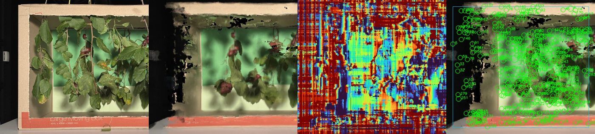

# First run on a real capture (8 November 2026)

`run_real.py` was run once on the five-branch capture (`data/2cm_74cm_5branches/images`, 28
photos, 20 mm steps, processed at 0.25 scale, 756 x 1008 px) with the OpenCV rail
structure from motion and no COLMAP model:

```bash
python3 has_sai/run_real.py --images data/2cm_74cm_5branches/images --spacing 0.02 --scale 0.25 \
    --poses sfm --fruit grape --radius-mm 7 14 --z-near 0.5 --z-far 1.35 --roi 40 280 460 655
```



Left to right: the centre photo, the leaf-free render, the background depth and the detections,
all cropped to the box. `five_branches_summary.json` holds every number.

What happened:

- **Poses.** The translation-only rail model fitted with 0.76 px reprojection RMSE; the
  recovered steps were 18.6 to 22.0 mm for a nominal 20 mm, and the camera path deviated 4 mm
  from a straight line over 0.54 m. Letting each photo rotate improved the RMSE to 0.64 px, below
  the 20 % gain needed to switch, so the rail prior was kept. No EXIF was present, so the focal
  length is the 26 mm-equivalent default.
- **Occlusion removal.** With the depth split and the wall estimate restricted to the box
  (`--roi`), the foliage split landed at 0.99 m and the wall at 1.23 m, and the leaf-free render
  removed most of the foreground foliage: the bunches behind the leaves are visible, with
  residual ghosting where leaves were close to the fruit and holes where no photo saw the wall.
  Without `--roi` the dark room around the box dominated the depth histogram and the wall
  estimate collapsed to the far limit.
- **Counting failed.** The background depth is noisy on the plain green backdrop, so the relief
  detector found 315 candidates above the threshold calibrated on the simulated cherries, against
  25 grapes. No real-photo calibration was attempted. This matches the simulation study, where the
  3-D detector was the fragile stage, and is why the report's final method aligns on fruit
  features and counts with GrapeSAM instead.
- **Time.** 39 s after the pose estimate (masks 7.6 s, background sweep 27.4 s, semi-global
  aggregation 1.1 s, render 3.1 s); the rail SfM on 28 photos at 2000 px took about three minutes
  with a pair gap of 6 and 8,000 features per photo.

The run was not used in the report. Its value is the leaf-free render, which shows the
depth-based line working on real photographs, and the negative counting result.
